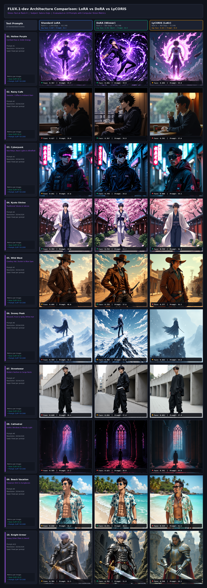
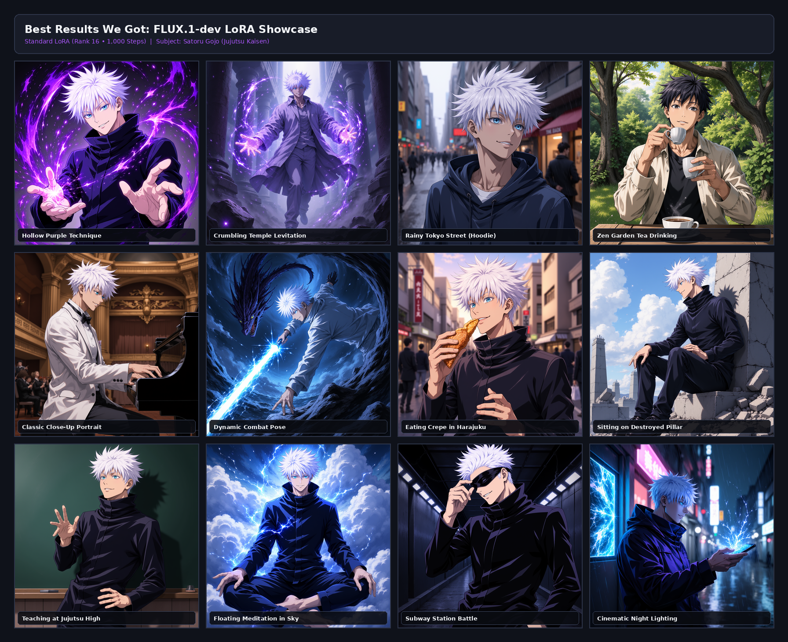
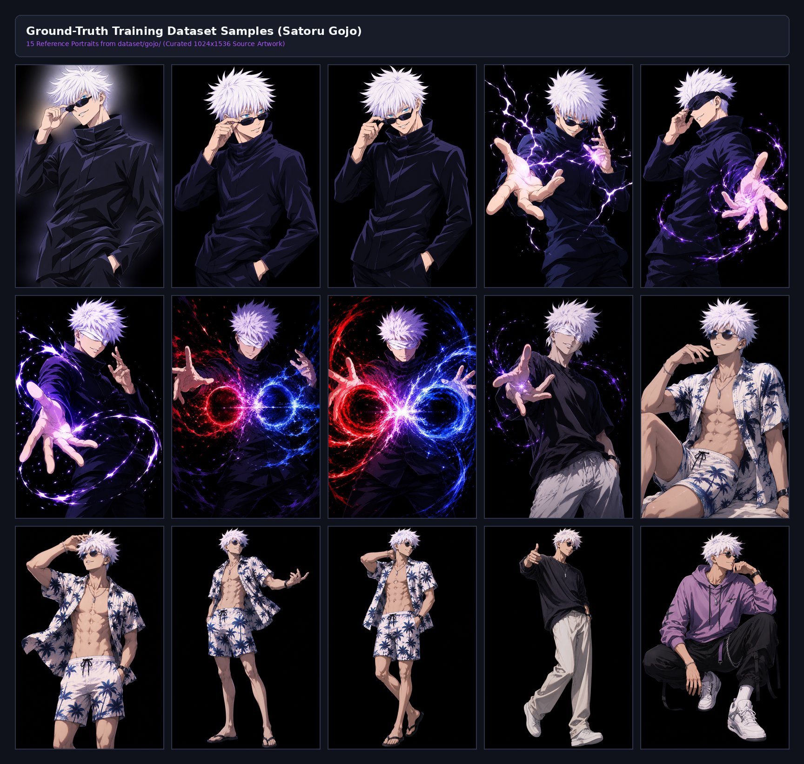

# FLUX.1-dev & SD LoRA Training Lab 🧪🎨
### Parameter-Efficient Fine-Tuning (PEFT) Benchmark: LoRA vs. DoRA vs. LyCORIS (LoKr)

A comprehensive exploration and empirical benchmark comparing Parameter-Efficient Fine-Tuning (PEFT) architectures (**Standard LoRA**, **DoRA - Weight-Decomposed Low-Rank Adaptation**, and **LyCORIS LoKr - Kronecker Product Adaptation**) on the state-of-the-art **12-Billion parameter FLUX.1-dev** Multimodal Diffusion Transformer (MM-DiT) and **Stable Diffusion v1.5**.

---

## 📊 Comprehensive Visual Benchmark Grid

Below is the side-by-side comparative benchmark across 10 distinct, challenging test prompts evaluating face identity fidelity (**CLIP-I Face Match**) and prompt consistency (**CLIP-T**) under a strict low-rank stress test (Rank 4):



---

## 🏆 Benchmark Scorecard & Key Findings

All models were evaluated under identical constraints (**Rank 4**) on 10 rigorous, high-variance scenarios (ranging from combat techniques to extreme lighting, armor, and streetwear):

| Architecture | Training Steps | Weight Size | Avg Face Match (CLIP-I) | Avg Prompt Score (CLIP-T) | Performance Summary |
| :--- | :---: | :---: | :---: | :---: | :--- |
| **DoRA** *(Weight-Decomposed)* | **600** | 49.2 MB | **0.742** 🏆 *(Best)* | 36.0 | **Clear Winner**: Directional + magnitude decomposition preserved identity across novel outfits & lighting. |
| **Standard LoRA** | **1,000** | 43.1 MB | **0.667** | **36.3** | High prompt flexibility, but face drifted under heavy styling changes. |
| **LyCORIS (LoKr)** | **600** | **9.5 MB** ⚡ *(Tiny)* | **0.615** | 34.8 | **Over 4.5× smaller file size** via Kronecker matrix factorization; ultra-lightweight. |

### 🔍 Per-Prompt Identity Preservation (CLIP-I)

| Prompt Scene | Standard LoRA (1,000s) | DoRA (600s) | LyCORIS (600s) | Scene Winner |
| :--- | :---: | :---: | :---: | :---: |
| **1. Hollow Purple (Combat)** | 0.768 | **0.846** | 0.699 | **DoRA** |
| **2. Rainy Cafe** | 0.627 | **0.767** | 0.592 | **DoRA** |
| **3. Cyberpunk Neon** | 0.641 | **0.770** | 0.600 | **DoRA** |
| **4. Kyoto Shrine (Yukata)** | **0.784** | 0.759 | 0.738 | **LoRA** |
| **5. Wild West (Cowboy)** | 0.699 | **0.729** | 0.577 | **DoRA** |
| **6. Snowy Mountain** | 0.594 | **0.709** | 0.683 | **DoRA** |
| **7. Modern Streetwear** | 0.620 | **0.656** | 0.641 | **DoRA** |
| **8. Gothic Cathedral** | 0.589 | **0.625** | 0.541 | **DoRA** |
| **9. Tropical Beach** | 0.650 | **0.775** | 0.534 | **DoRA** |
| **10. Silver Knight Armor** | 0.704 | **0.782** | 0.540 | **DoRA** |

---

## 🖼️ Additional Result Showcases

### LoRA Fidelity & Style Progression


### Curated Training Dataset Grid


---

## 🛠️ Repository Architecture & Workflows

```
├── codes/
│   ├── train.py                        # Modal serverless FLUX training pipeline
│   ├── train_dora_rank4.py             # DoRA adapter training script
│   ├── train_lycoris_rank4.py          # LyCORIS / LoKr adapter training
│   ├── modal_server.py                 # FastAPI + Modal GPU inference microservice (A100-80GB)
│   ├── sagemaker_flux/                 # AWS SageMaker distributed training & auto-restart monitors
│   │   ├── launch_all_three.py         # Concurrent SageMaker launch orchestrator
│   │   ├── train.py                    # ai-toolkit SageMaker entrypoint
│   │   └── auto_monitor_restart.py     # Autonomous training health & spot resume monitor
│   ├── sagemaker_src/                  # SageMaker PyTorch container routines
│   ├── compute_metrics.py              # Automated CLIP-I / CLIP-T benchmark pipeline
│   └── create_comparison_grid.py       # High-resolution benchmark matrix generator
├── dataset/                            # Training imagery and high-precision descriptive captions
├── frontend/                           # Interactive Web UI for live comparative generation
├── pixel art/                          # Pixel-art LoRA experiments, chroma-keying & cleanup pipelines
├── results/                            # Benchmark reports, metrics CSV/JSON, and generated images
└── local_app.py                        # Local preview server
```

---

## 🚀 Quickstart & Setup

### 1. Clone & Install Dependencies
```bash
git clone https://github.com/Black-sys-dot/LORA_training.git
cd LORA_training
python3 -m venv venv
source venv/bin/activate
pip install -r requirements.txt
```

### 2. Environment Configuration
Copy the sample environment file and configure your credentials:
```bash
cp .env.example .env
```
Fill in your tokens in `.env`:
* `HF_TOKEN`: Hugging Face User Access Token (required for FLUX.1-dev gated weights).
* `AWS_REGION` / `AWS_ACCOUNT_ID` / `SAGEMAKER_ROLE_ARN` / `SAGEMAKER_BUCKET`: (Optional) Required only if running AWS SageMaker training jobs.

### 3. Launch Local Dashboard
```bash
python3 local_app.py
```
Open [http://localhost:8001](http://localhost:8001) in your browser to inspect generated comparisons and prompt libraries.

---

## 📜 License & Acknowledgements
* Base models: [FLUX.1-dev](https://huggingface.co/black-forest-labs/FLUX.1-dev) by Black Forest Labs & Stable Diffusion v1.5.
* Training Frameworks: [ai-toolkit](https://github.com/ostris/ai-toolkit), [PEFT](https://github.com/huggingface/peft), and [Diffusers](https://github.com/huggingface/diffusers).
